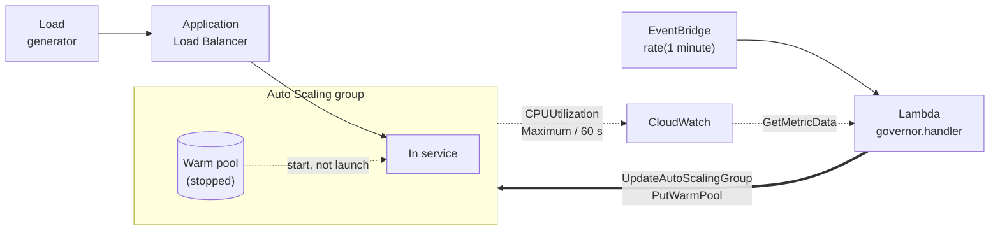
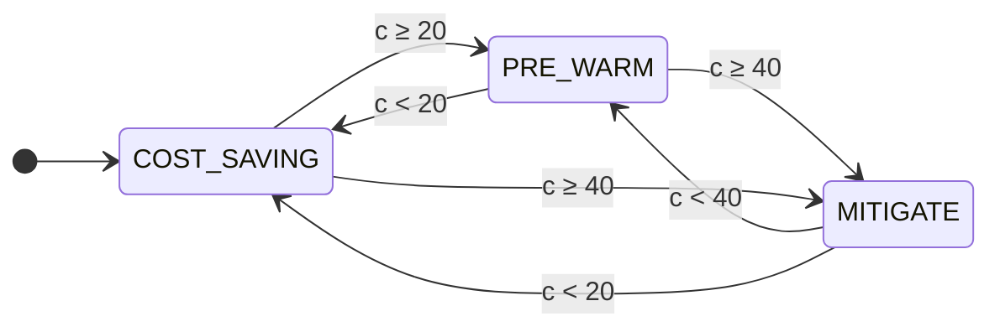
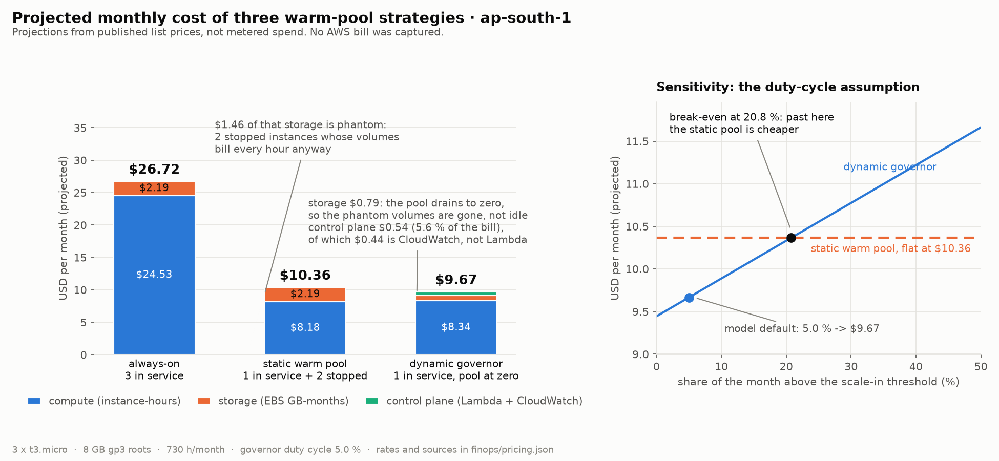
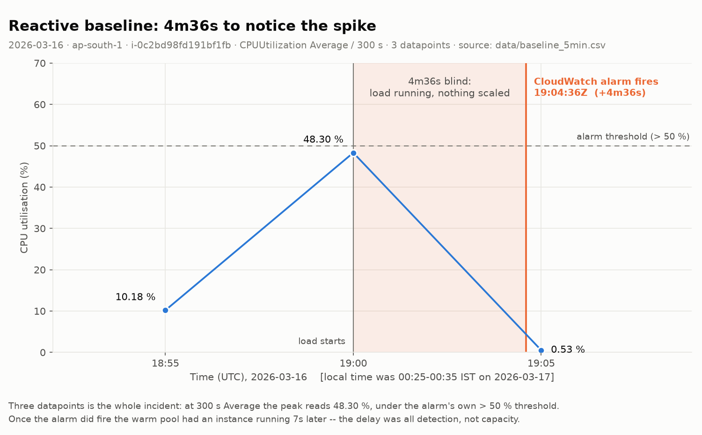
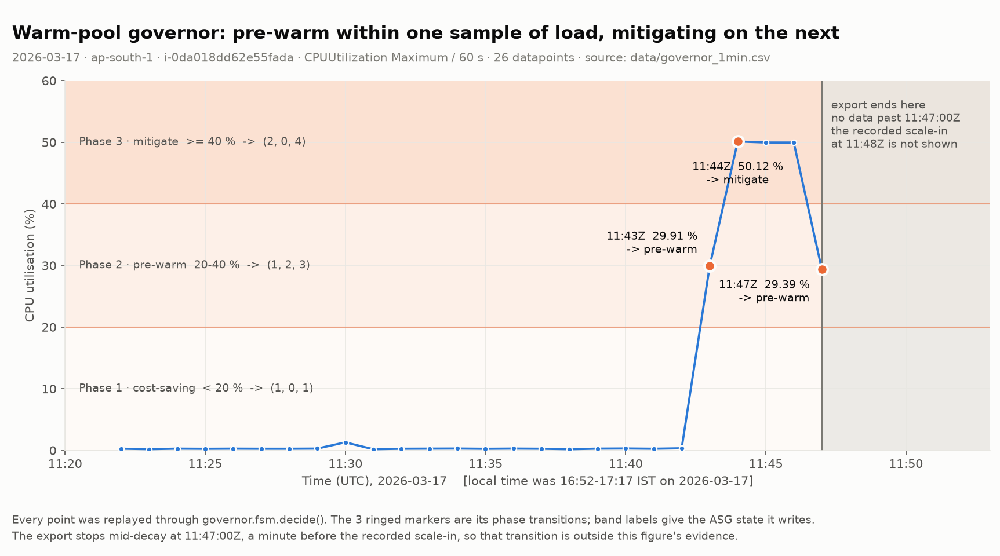

# Cloud Pool Manager

[](https://github.com/raghavguptaa/Cloud-pool-manager/actions/workflows/ci.yml)

**AWS gives you a warm pool you size once, by hand — and no scaling policy will ever resize it
for you. Every policy AWS offers moves `DesiredCapacity` and nothing else. So you choose up
front: pay for standby capacity around the clock, or cold-start when the spike lands.**

**This is the missing piece — a deterministic controller that sizes the warm pool itself, from
live CPU, once a minute.**

Three comparisons and a lookup table. No model, no training data, no forecast: `decide()` is
O(1), pure, and exhaustively testable by enumerating its boundaries.

The telemetry in `data/` was captured from a live AWS deployment I ran in March 2026. The
account has since been closed, so this data cannot be regenerated — which is why the entire
repository is built to be verified offline, with no credentials, by anyone who clones it.

```
$ make test
604 passed
```

---

## The gap AWS leaves

A warm pool holds instances that have been launched, have run their user data, and have then
been **stopped**. Restarting a stopped instance skips first boot entirely — the boot cost is
still paid, just in advance and off the critical path.

It is not free. A stopped instance keeps its EBS volume, and that volume bills every hour
whether or not anything is running. A permanently warm pool trades a latency bill for a storage
bill.

AWS will auto-maintain warm pool *occupancy* against a ceiling — pool size is
`MaxGroupPreparedCapacity − DesiredCapacity`, so it refills as capacity moves. What it has no
native mechanism for is moving that ceiling, or the pool's minimum, **in response to a metric**.
`MinSize` and `MaxGroupPreparedCapacity` are static configuration written through `PutWarmPool`;
every scaling policy on offer — simple, step, target tracking, predictive — adjusts
`DesiredCapacity` and nothing else.

That leaves two fixed choices, and you have to pick one when you write the Terraform:

| | Cold-start latency | Idle cost |
|---|---|---|
| No warm pool | full boot on every scale-out | none |
| Warm pool sized for peak | none | stopped instances' EBS, billed around the clock |

**This controller is the link between them.** A live metric drives the pool's *own* parameters,
so warm capacity exists while load justifies it and drains to zero when it does not — which is
the third row that AWS does not offer you.

Both thresholds are data rather than literals, so the bands are a deployment decision, not a
code change:

```hcl
# terraform.tfvars — no code edit, no redeploy of the function
scale_in_threshold = 15   # drain the pool below this
pre_warm_threshold = 35   # pull pooled capacity into service at or above this
```

The same two values are readable from `SCALE_IN_THRESHOLD` / `PRE_WARM_THRESHOLD` on the Lambda,
or passed directly as `Config(scale_in_threshold=..., pre_warm_threshold=...)` in the replay.

It is also *faster* than waiting for an alarm — [measurably so](#latency), by 2m43s in the run
it was captured on. But that is the supporting result. Turning on detailed monitoring makes an
alarm fire sooner too; it does not drain a warm pool when load subsides, and it does not
pre-warm one before a spike.

## Architecture



## The controller

Three phases, chosen from one number. Given CPU utilisation `c` and thresholds
`θ_in = 20 %`, `θ_warm = 40 %`:

```
                 ⎧ COST_SAVING   if        c <  θ_in
    phase(c)  =  ⎨ PRE_WARM      if θ_in ≤ c <  θ_warm
                 ⎩ MITIGATE      if        c ≥ θ_warm
```

Each phase maps to a fixed triple of Auto Scaling settings. The middle two columns are the ones
nothing native will write for you:

| Phase | CPU | `DesiredCapacity` | `WarmPoolMinSize` | `MaxGroupPreparedCapacity` | Intent |
|---|---|---|---|---|---|
| `COST_SAVING` | `< 20 %` | 1 | 0 | 1 | Drain the pool. Stop paying for volumes no traffic justifies. |
| `PRE_WARM` | `20–40 %` | 1 | 2 | 3 | Boot two instances into the pool, out of traffic, ahead of the spike. |
| `MITIGATE` | `≥ 40 %` | 2 | 0 | 4 | Extract pooled capacity into service; raise the ceiling to re-prepare behind it. |



Every transition is drawn because the machine is **memoryless**: the phase depends only on
the current sample, never on the previous phase, so any phase can follow any other in one
tick. `decide()` is a pure function — no clock, no I/O, no boto3 — which is what lets the
offline replay run the exact code path the deployed Lambda ran.

Two design notes worth stating plainly:

- **It is a dead-band, not hysteresis.** The original design calls the 20–40 % gap a
  hysteresis band. True hysteresis needs distinct rising and falling thresholds, which needs
  the previous phase fed back in. A memoryless dead-band still suppresses flapping around a
  single threshold, so the practical effect is close — but the distinction is real.
- **Why not a predictor?** A forecaster needs training data, a retraining story, and an answer
  for what happens when it is confidently wrong. Three comparisons need none of those, run in
  constant time, and are exhaustively testable by enumerating boundaries — which
  `tests/test_fsm.py` does, 465 times. For something that fires every minute and moves real
  money, provably boring beats probably smarter.

### The part that isn't a class assignment

`run_once()` reads the group's current configuration and **writes nothing when it already
matches the decision**. In steady state — which is almost always — an invocation is two reads
and zero writes.

Without that check the function issues ~1,440 mutating API calls per group per day to
re-assert a configuration that was already correct: burning Auto Scaling request quota,
filling CloudTrail with noise that hides real changes, and risking a scaling activity on every
tick. The write path also orders its two API calls by which direction the ceiling is moving,
because Auto Scaling enforces `MaxGroupPreparedCapacity ≥ DesiredCapacity` on *every* call —
so the intermediate state between the two writes has to be legal too.

A metric gap is treated as missing information, not as 0 %. Reading it as idle would drain the
warm pool at precisely the moment the monitoring pipeline is broken — a self-inflicted outage
triggered by a telemetry failure. The controller holds instead.

## What it buys

### Cost

This is the result that rests on dynamic sizing, and it is the one with no reactive equivalent
to compare against. `make finops` builds a monthly projection from ap-south-1 list prices, each
rate carrying the AWS page it was read from and the date, in `finops/pricing.json`.



| Scenario | Compute | Storage | Control plane | Total |
|---|---|---|---|---|
| Always-on (3 × t3.micro, 24/7) | $24.53 | $2.19 | — | **$26.72** |
| Static warm pool (1 in service + 2 stopped) | $8.18 | $2.19 | — | **$10.36** |
| Dynamic governor (1 in service, pool at zero) | $8.34 | $0.79 | $0.54 | **$9.67** |

**63.8 % below always-on; 6.7 % below a static warm pool.** These are projections from a
pricing model, **not metered spend** — no bill was captured for this architecture and none
ever can be.

Three things the model turned up that the original projection did not:

1. **The control plane's cost is the wrong shape.** CloudWatch costs 4.4× what the Lambda
   does. `GetMetricData` bills per metric requested and is one of the few CloudWatch APIs the
   free tier excludes — so the *poll interval*, not the function, sets the control plane's
   price.
2. **The margin over a static pool is entirely phantom storage,** and it inverts. Break-even
   is at a **20.8 % duty cycle**: past that, the governor's extra compute outweighs the
   stopped volumes it avoids and a static pool is simply cheaper. At 8 GB roots the advantage
   is thin; at 100 GB roots it is the entire argument. Quoting one number without the volume
   size attached is quoting half a result.
3. **The original's absolute dollars don't reconcile, and the error runs against its own
   story.** It reports $24.95/month for the always-on arm; that is a compute-only figure
   (3 × t3.micro at 744 h lands within $0.05 of it) with EBS omitted — ironic, since phantom
   storage is the mechanism the governor's advantage rests on. Its *ratios*, by contrast,
   reproduce almost exactly: costing the controller as the Lambda alone gives 65.5 % and
   11.0 % against the original's 65 % and 11 %.

No calibration constant was added to close the gap. `tests/test_cost_model.py` pins which
claims reproduce and which do not, so a future edit cannot turn a documented gap into a silent
agreement.

### Latency

Supporting evidence, and the weaker of the two claims — read the caveat at the end of this
section before quoting the number.

Scale-out is usually reactive: a CloudWatch alarm watches CPU, and when it breaches, Auto
Scaling adds capacity. At default (basic) monitoring, EC2 publishes `CPUUtilization` every five
minutes.



The entire spike-and-recovery is **three datapoints**, and the peak reads 48.3 % — under the
alarm's own 50 % threshold, because a 300-second *average* has already flattened the burst that
triggered it. The alarm took **4m36s** to fire.

Once it did fire, a warm-pool instance was in service **7 seconds later**. This baseline is not
a straw man: it already had a warm pool, statically sized, sitting there the whole time.
Capacity was never the bottleneck. *Detection* was.



Polling a 1-minute `Maximum` directly skips alarm evaluation entirely. Load starts; the very
next sample reads 29.91 % and the controller pre-warms. One sample later it reads 50.12 % and
pulls the pre-booted instances into service.

| | Reactive baseline | Governor |
|---|---|---|
| Metric resolution | `Average` / 300 s | `Maximum` / 60 s |
| Detection | 4m36s (alarm fires) | 1m00s (one sample) |
| To mitigating capacity | **4m43s** | **2m00s** |

**2m43s earlier — 2.36× faster.** The governor's 2m00s is one period to observe the spike plus
one period for that bucket to publish; both are floors set by the metric pipeline, not by the
code.

> **Caveat, and it is a real one.** The two arms changed metric resolution *and* control
> mechanism at the same time, so this run cannot apportion the 2m43s between them. I would
> expect 1-minute metrics to account for most of it. Separating them needs a third arm —
> reactive step scaling on 1-minute metrics — which is the first thing I would run next. This
> is why latency is the supporting result here and cost is the headline: faster metrics make an
> alarm fire sooner, but they do not size a warm pool.

### Reproducing the observed run

`sim/replay.py` feeds `data/governor_1min.csv` — all 26 samples, unsmoothed and unresampled —
back through the same `governor.fsm.decide()` the Lambda called, and diffs the resulting state
timeline against the timeline recorded by hand during the run.

```
11:42:00Z       0.34  cost_saving        1         0         1
11:43:00Z      29.91  pre_warm           1         2         3  -> pre_warm
11:44:00Z      50.12  mitigate           2         0         4  -> mitigate
11:45:00Z      49.95  mitigate           2         0         4
```

`tests/test_replay.py` pins those facts, so **CI fails if the implementation ever stops
reproducing what was observed on AWS on 2026-03-17.** Change a threshold, a state vector or a
comparison operator, and the suite says so. The expected values are the raw ones
(`29.907834869418842`, not `29.91`) — a rounded expectation would still pass if someone
quietly reformatted its input.

The replay reports 4 agreements, 1 disagreement and 2 rows it cannot cover. Those last three
are not swept up:

- The retained export **stops at 11:47:00Z**, one minute before the scale-in it is supposed to
  evidence. `test_recorded_scale_in_is_a_known_gap` asserts the replay still reports that row
  as unverifiable — if a future change quietly started "covering" it, the suite fails.
- Inside the window, the export's falling edge (49.95 % at 11:46Z) contradicts the recorded
  timeline's "< 15.0 %". The rising edge agrees to three decimal places; the falling edge does
  not. See [`data/PROVENANCE.md`](data/PROVENANCE.md).

**So: the spike-detection and mitigation half of the run is fully supported by the retained
telemetry. The scale-in half is not.** That is stated here rather than cropped out of a chart.

## Verify it yourself

Nothing below needs an AWS account, credentials, or a network connection.

```bash
git clone https://github.com/raghavguptaa/Cloud-pool-manager
cd cloud-pool-manager
make venv && source .venv/bin/activate

make test     # 604 tests: FSM boundaries, adapter vs moto, cost model, replay vs telemetry
make sim      # replays data/*.csv, regenerates results/fig1 and fig2
make finops   # cost table + sensitivity, regenerates results/finops.png
```

`make validate` additionally runs `terraform validate`, `tflint` and `checkov` over
`terraform/`. It needs those three tools on `PATH`; CI runs it on every push, so the usual
local loop is `make lint test sim finops`.

The figures in `results/` are committed *and* regenerated by `make sim`. Rendering is
deterministic — `test_figure_rendering_is_deterministic` asserts byte-equality on a given
toolchain.

## Deploying it

`terraform/` stands up the whole architecture in a fresh account as one flat root module,
using the default VPC on purpose (a hand-rolled VPC would add a NAT gateway and subnet
arithmetic to a module whose subject is capacity control).

```bash
cd terraform
cp example.tfvars terraform.tfvars   # edit region, thresholds, allowed_http_cidr
terraform init && terraform apply
```

`var.scaling_mode` selects which arm of the experiment gets deployed:

- `"baseline"` — CloudWatch alarm + step scaling policy, **basic** monitoring, and a
  **statically sized** warm pool that nothing ever resizes.
- `"governor"` — the same warm pool, **sized by the Lambda every 60 s**, with **detailed**
  monitoring and no step policy.

Both arms get a warm pool, because the captured baseline run had one — its alarm reached a
pooled instance in 6 seconds. Withholding it from the reactive arm would add ~180 s of cold boot
to the thing under comparison and credit the controller with a difference that was never
measured. What differs between the arms is *who sizes the pool*.

They are mutually exclusive by design. Running both against one group would let the step
policy and the controller issue conflicting capacity writes, and you would be measuring the
argument between them rather than either strategy. Detailed monitoring is deliberately *off*
in baseline mode — quietly enabling it there would improve the arm being measured against and
erase the difference under test.

The Lambda's IAM role gets exactly five actions, with the two that can change anything scoped
to the one group's ARN. Deploy with `dry_run = true` first: the controller logs the capacity
decision it would have made and writes nothing. See [`terraform/README.md`](terraform/README.md).

## Repository layout

| Path | What it is |
|---|---|
| `governor/fsm.py` | The decision function. Pure, O(1), no I/O. The contract everything imports. |
| `governor/config.py` | Thresholds and the phase → state table, as data rather than literals. |
| `governor/aws_adapter.py` | boto3 layer: read metric, read state, write only what differs, retry what's worth retrying. |
| `governor/handler.py` | Lambda entrypoint and environment validation. |
| `sim/` | Offline replay of `data/` through `fsm.decide()`, plus figure generation. |
| `finops/` | Monthly cost model; `pricing.json` carries a dated source URL per rate. |
| `terraform/` | Both experimental arms, selected by `var.scaling_mode`. |
| `data/` | The captured CloudWatch exports and hand-recorded timelines. Read-only inputs. |
| `tests/` | 604 tests. |

## Limitations, and what I'd do differently

This is a single run captured in an afternoon, and the honest reading of it is narrower than
the headline numbers suggest.

**The measurement**

- **n = 1 per arm.** One run each, no repeated trials, no confidence interval. A second run
  could land anywhere and nothing here would catch it.
- **The latency delta is confounded.** Different days (03-16 vs 03-17), different instances,
  and — the one that matters — different metric resolution. Switching to detailed monitoring and
  switching to a polled controller happened *together*, so this data cannot apportion the 2m43s
  between them. Both arms had warm capacity standing by, so the gap is detection rather than
  boot, and I would expect 1-minute metrics to account for most of it. Separating them needs a
  third arm — reactive step scaling on 1-minute metrics — and that is the first thing I would
  run next. Note what this does *not* limit: faster metrics make an alarm fire sooner, they do
  not size a warm pool. The dynamic-sizing claim has no reactive equivalent to be confounded
  with (see [The gap AWS leaves](#the-gap-aws-leaves)); it is the cost result, not the latency
  result, that rests on it.
- **The load never went through the load balancer.** Load was generated on the instance
  itself — `sha256sum` over `/dev/zero` via EC2 Instance Connect — deliberately, to avoid
  network variables polluting instance-level CPU. It means CPU is clean, and it also means
  nothing here measures request latency, queueing, or connection draining. "Latency
  mitigation" is inferred from capacity timing, not observed at the request.
- **The baseline series is three datapoints.** Enough to show that 300-second averaging hides
  the spike; not enough to characterise anything.
- **Wall-clock events were read off the console by hand**, so ±1 s at best.
- **The export ends before the scale-in it should evidence** (see above).

**The design**

- **20 % and 40 % are magic numbers.** Nothing here justifies them over 25/45 or 30/60. They
  are configurable, and the sensitivity analysis shows the cost side is dominated by duty
  cycle rather than by threshold placement — but a principled derivation from boot time and
  arrival rate would be better than two round numbers.
- **The original design spec contradicts itself on scale-in** — 20 % in the formula, "< 15.0 %"
  in the run narrative. Both are reachable (`DEFAULT` and `SCALE_IN_15`), and neither is
  treated as privileged, because the captured telemetry has *zero* samples in [15 %, 20 %) and
  so cannot settle it. `sim/replay.py` prints that finding rather than picking a winner.
- **60-second polling is itself a latency floor**, and the original design does not account for
  it. Worst case, a spike arrives just after a poll and waits a full period before anything
  looks — so the controller's own sampling interval sits inside the number it is optimising.
- **Costs are projected, not metered.** Every dollar figure is a list price times a modelled
  quantity.
- **A dead-band is not hysteresis** (see above).
- **Single AZ behaviour, no failure testing.** No instance-failure, AZ-failure or
  API-throttling scenario was ever exercised against the live deployment. The adapter's retry
  and metric-gap paths are unit-tested; they have never met a real outage.

**What I'd build next**

The seams are already in place. `ScalingBackend` is a three-method `Protocol`, so a LocalStack
or GCP managed-instance-group backend slots in without touching `fsm.py`, and `terraform/` is
parameterised by region and profile. The next milestone is a live re-run with the third arm
above and repeated trials — same code, real data, a result that can carry an error bar.

## License

MIT — see [LICENSE](LICENSE).
